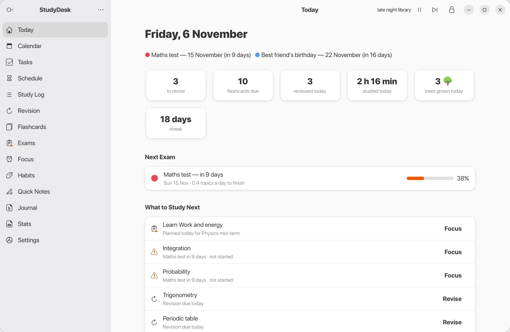
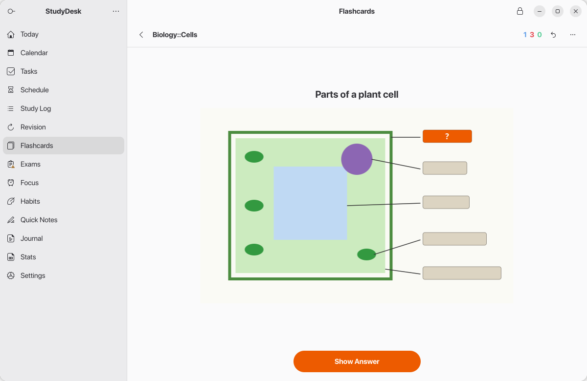
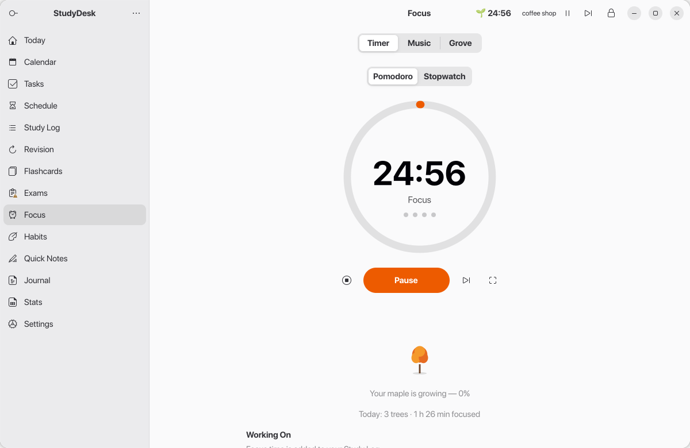
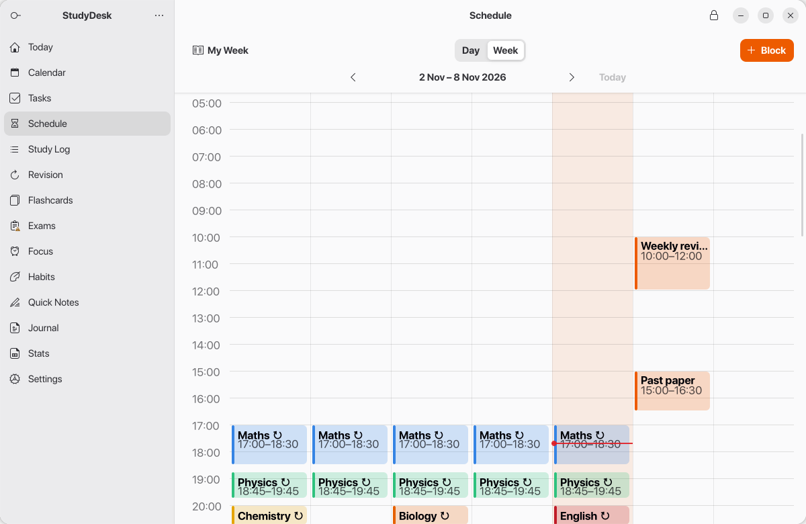

# StudyDesk

**One app for everything around studying: free, offline and private.**

StudyDesk is a study planner for school and college students. Plan what to learn, remember it
with spaced repetition, stay focused, and see your progress, all in one place. It works without
the internet, and everything you put in it is **encrypted with your password** and never leaves
your computer.

### ⬇️ [Download the latest version](https://github.com/pradipta-kalita/studydesk-download/releases/latest)

| Your computer | Download this file |
|---|---|
| **Windows 10 or 11** (64-bit) | `StudyDesk-<version>-Setup.exe` |
| **Ubuntu 26.04** | `studydesk_<version>_amd64.deb` |



## What's inside

- **Today**: one page that tells you what to study next, today's timetable, tasks and habits.
- **Study log**: subjects, topics, books, and the time you spend on each.
- **Revision**: topics come back just before you'd forget them (spaced repetition, FSRS).
- **Flashcards**: Anki-style decks with basic, reversed, fill-in-the-blank, image and
  **image-occlusion** cards (cover the labels on diagrams and maps). Imports Anki `.apkg` decks.
- **Tasks** (Kanban boards), a **weekly timetable** with reminders and alarms, and a **calendar**.
- **Exams**: countdown, how ready you are, and a day-by-day study plan.
- **Focus**: Pomodoro timer and stopwatch, study music, a **website blocker** you can't switch
  off mid-session, and a **forest** that grows with every session you finish.
- **Habits**, **quick notes**, a daily **journal**, and **statistics**.







## Installing on Windows

1. Download `StudyDesk-<version>-Setup.exe` from the
   [latest release](https://github.com/pradipta-kalita/studydesk-download/releases/latest).
2. Double-click it. Windows will probably show a blue **"Windows protected your PC"** box. That's
   because the installer isn't code-signed (signing costs money), not because anything is wrong.
   Click **More info**, then **Run anyway**.
3. Click **Next → Install → Finish**. No administrator password is needed: StudyDesk installs
   just for your account.
4. Open **StudyDesk** from the Start menu or your desktop.

> Your browser may also say the file "isn't commonly downloaded". Choose **Keep**.

## Installing on Ubuntu

The Linux package is for **Ubuntu 26.04** (it needs Python 3.14 and GTK 4 with libadwaita 1.9).

```bash
sudo apt install ./studydesk_<version>_amd64.deb
```

Then open **StudyDesk** from your app menu.

## The first time you open it

1. **Create a password.** It encrypts everything you put in StudyDesk.
2. **Save your recovery key.** StudyDesk shows it once, right after you create your password.
   Write it down or take a photo of it. If you forget your password *and* lose the recovery key,
   nobody can get your data back: that's what keeps it private.
3. Add your subjects in **Study Log**, and look at the **Today** page every day.

## Uninstalling

- **Windows:** Settings → Apps → Installed apps → **StudyDesk** → Uninstall.
- **Ubuntu:** `sudo apt remove studydesk`

Uninstalling keeps your study data, so you can reinstall later and pick up where you left off.
It lives in `%LOCALAPPDATA%\StudyDesk` on Windows and `~/.local/share/studydesk` on Ubuntu;
delete that folder if you want it gone too.

## Privacy

- StudyDesk never connects to the internet. No accounts, no ads, no tracking.
- Your data is encrypted with your password (Argon2id and AES-256-GCM).
- The website blocker filters only the *names* of websites during your focus sessions. It never
  sees what you read or type.

## Checking your download (optional)

Each release includes `SHA256SUMS.txt`. On Windows, run
`certutil -hashfile StudyDesk-<version>-Setup.exe SHA256` in a terminal; on Ubuntu,
`sha256sum -c SHA256SUMS.txt`. The numbers should match.

## Problems or ideas?

[Open an issue](https://github.com/pradipta-kalita/studydesk-download/issues) and describe what
happened. Screenshots help!

## Open-source components

The Windows installer bundles open-source software from the MSYS2 project: Python, GTK,
libadwaita, GStreamer and their libraries. Each release lists them with exact versions in
`windows-bundled-packages.txt`. Their licences are installed alongside StudyDesk, and their source
code is available from [repo.msys2.org](https://repo.msys2.org/mingw/sources/).
